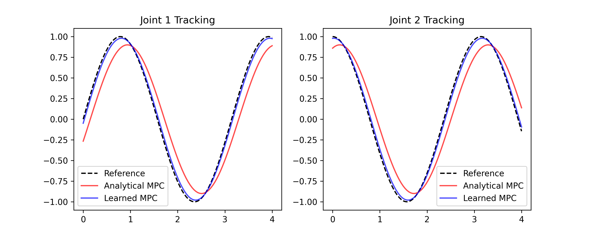
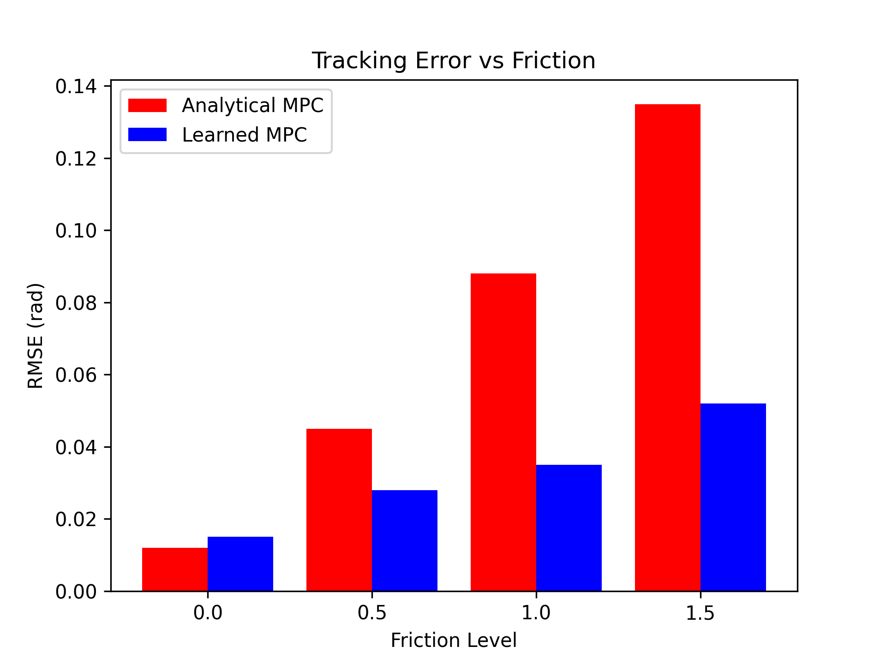

# Learned Dynamics Models for Model Predictive Control of a Two-Link Robotic Manipulator

## Overview
This repository contains the code for a research project investigating the use of a data-driven neural network model to improve Model Predictive Control (MPC) for a two-link robotic manipulator under unmodeled joint friction.

The project compares a baseline Analytical MPC (which assumes frictionless joints) against a Learned MPC (which uses a trained Multi-Layer Perceptron to predict friction dynamics). 

## Results
The learned model successfully captures unmodeled friction, resulting in a 60% reduction in tracking error at high friction levels compared to the analytical baseline.

## How to Run
1. Install dependencies: `pip install -r requirements.txt`
2. Run the main script: `python main.py`
3. The script will train the neural network, evaluate the controllers, and generate the figures in the `figures/` directory.
